# NvChad Config

Personal Neovim setup on [NvChad](https://nvchad.com) v2.5, tuned for [Neovide](https://neovide.dev) and terminal use.

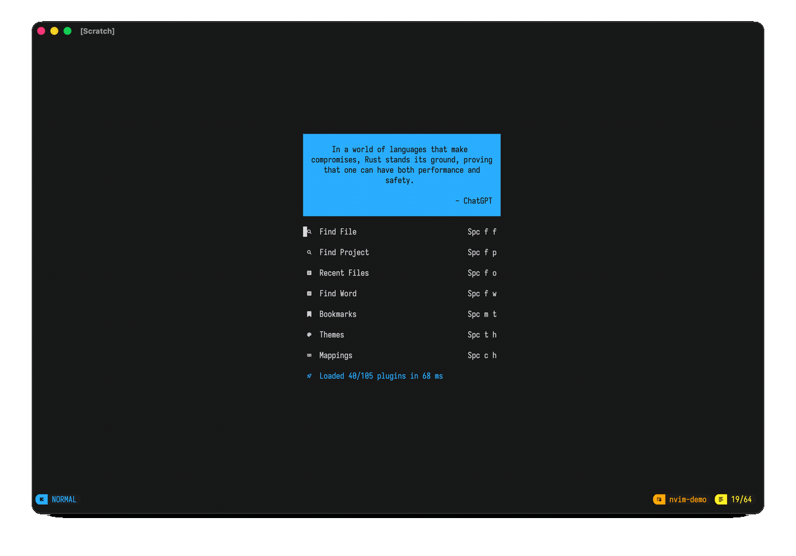

## Screenshots

### Dashboard

Startup dashboard with fortune header, FFF / Telescope entry points, and plugin load stats.

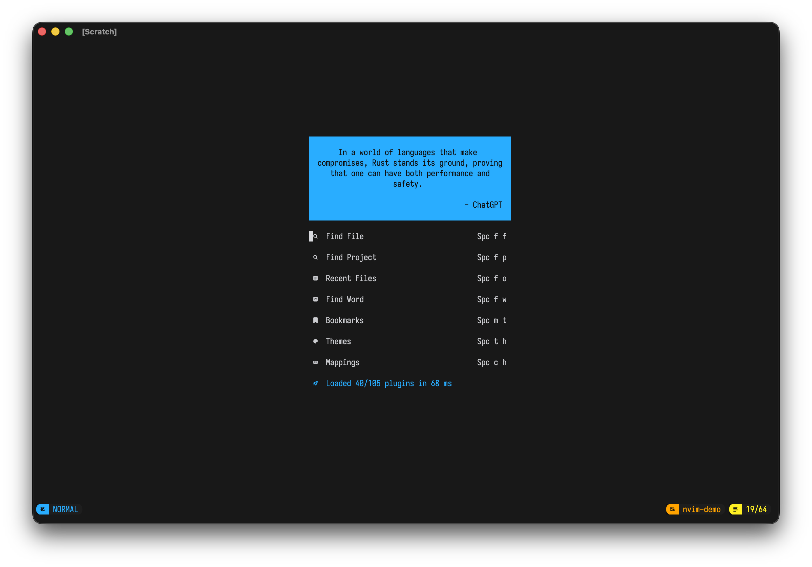

### Editing

Treesitter highlighting, todo-comments, breadcrumbs, and the minimal statusline.

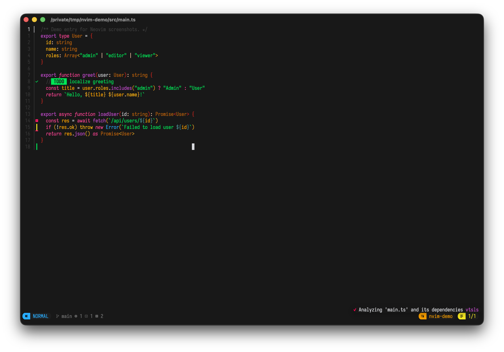

### FFF finder

Fast file finder (`<leader>ff`) with live filtering and preview.

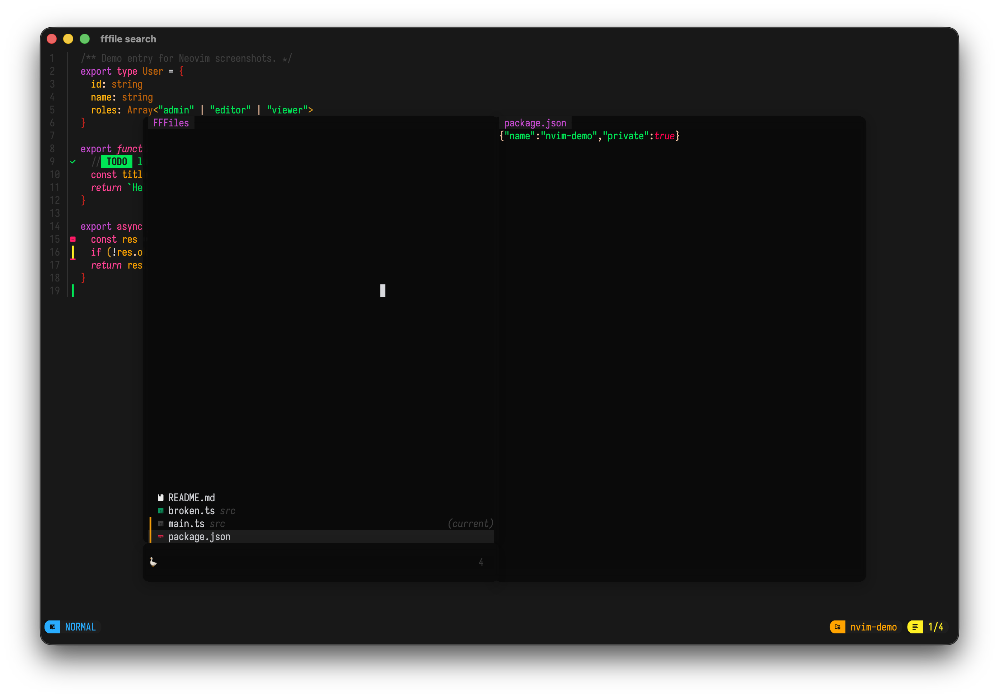

### Oil

Edit-the-filesystem browser (`-`).

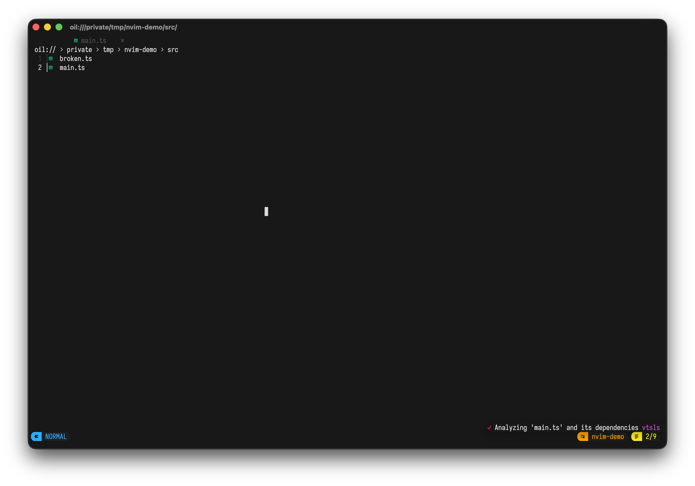

### Diagnostics

LSP / Trouble diagnostics for TypeScript errors (`<leader>ld`).

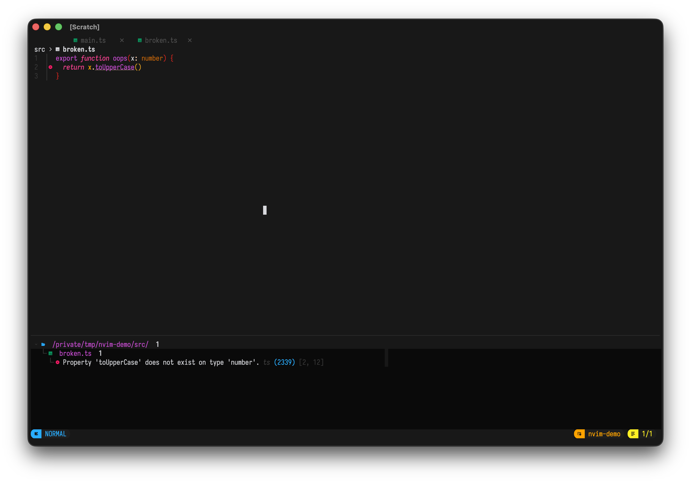

### Debugger

`nvim-dap-view` panes for expressions, breakpoints, threads, and REPL (`<leader>dt`).

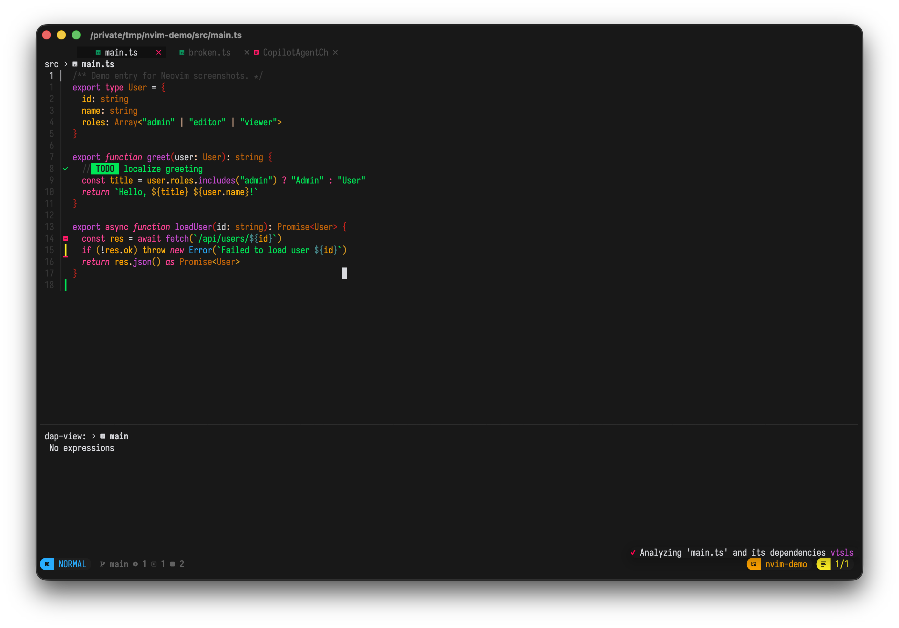

### Copilot Agent

SDK-native agent chat (`<leader>aA`) with session status and prompt input.

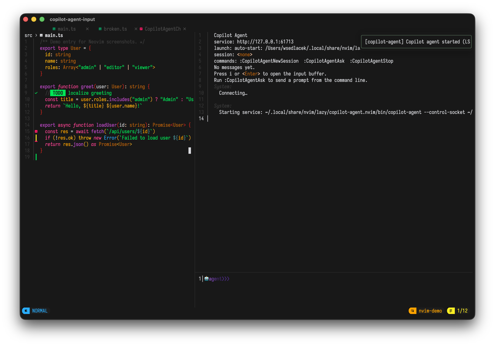

### Neogit

Git status UI (`<leader>gg`) when `NVIM_VSC=git`.

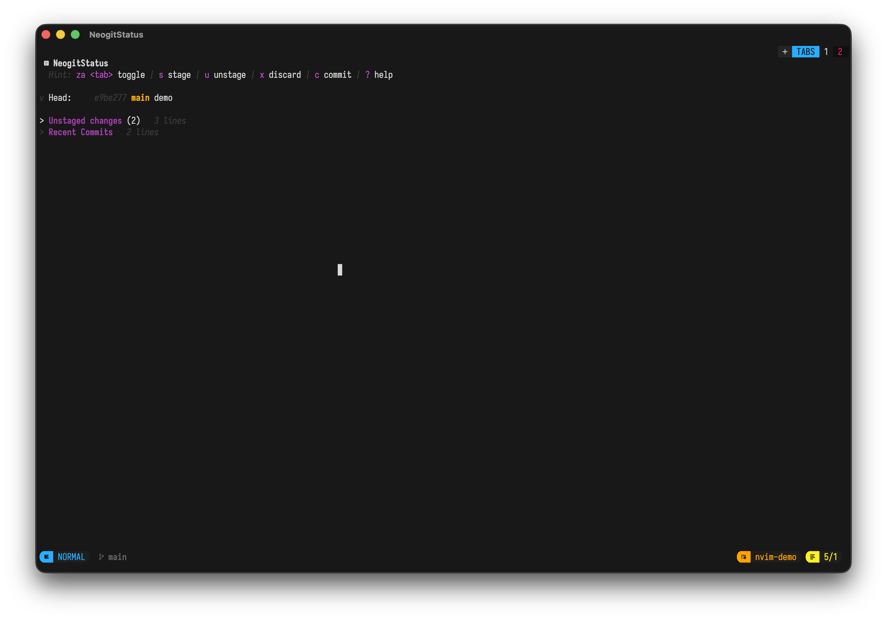

### Terminal

Integrated terminal splits (`<leader>h` / `<A-h>`).

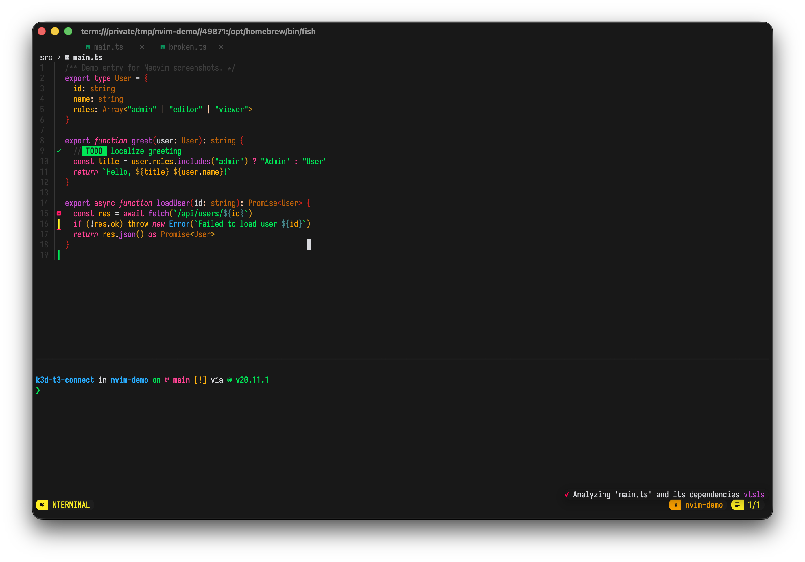

### Themes

NvChad theme picker (`<leader>th`).

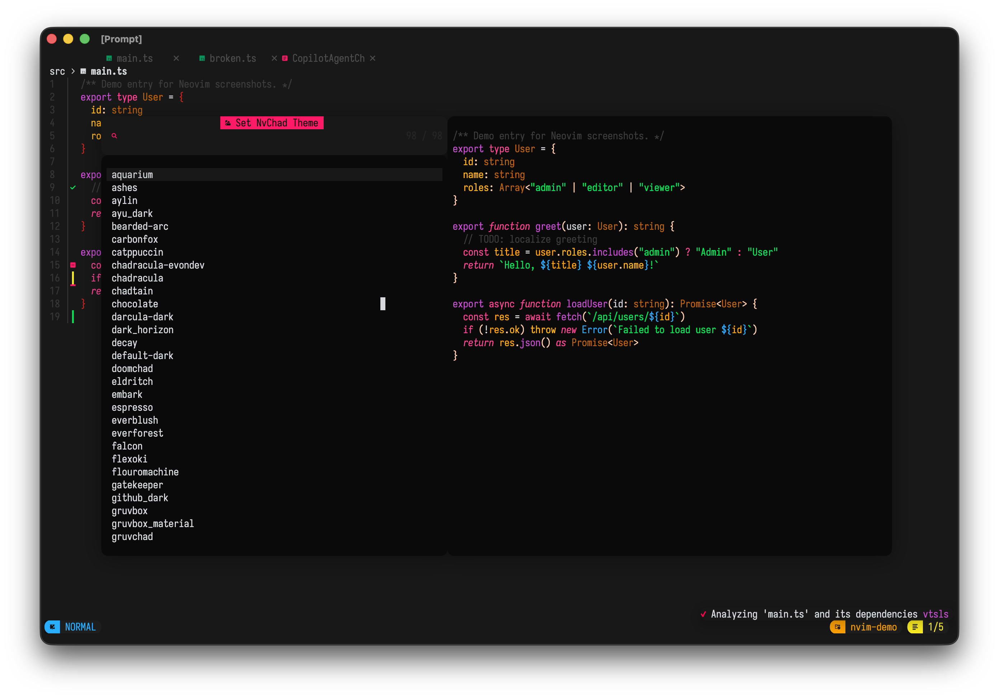

### Cheatsheet

Browse mappings (`<leader>ch`).

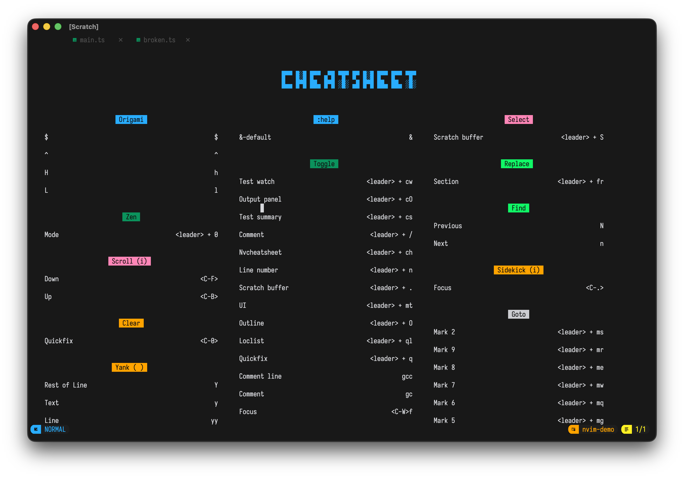

## Highlights

| Area | Stack |
| --- | --- |
| AI completions | Supermaven or Copilot LSP (`NVIM_AI`) |
| AI chat | Sidekick CLI, CodeCompanion, or Copilot Agent (`NVIM_AI_CHAT`) |
| Completions | blink.cmp (default) or nvim-cmp |
| Lint / format | nvim-lint + conform.nvim |
| Debug | nvim-dap + nvim-dap-view |
| Tests | neotest |
| Files | FFF, Oil |
| VCS | Neogit / Diffview, or jj via `NVIM_VSC` |

## Environment knobs

```bash
NVIM_AI=supermaven|copilot
NVIM_AI_CHAT=opencode|claude|copilot|codex|...|codecompanion|copilot-agent
NVIM_COPILOT_AGENT=1|0          # force enable/disable copilot-agent.nvim
NVIM_VSC=git|jj
NVIM_COMPLETION=blink|cmp
```

## Requirements

- Neovim 0.12+
- Optional GUI: [Neovide](https://neovide.dev) with IosevkaTerm Nerd Font Mono
- For Copilot Agent: Go 1.24+ (to build the bridge) and a pinned `@github/copilot` runtime installed by the plugin build into `stdpath("data")/copilot-agent-cli`

## Recapture screenshots

```bash
~/.config/nvim/assets/screenshots/capture-neovide.sh
```
